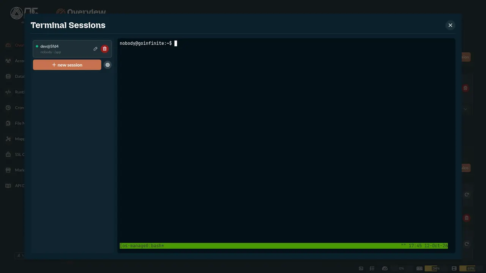

# [Infinite OS](https://goinfinite.net/os/) &middot; [](https://github.com/orgs/goinfinite/projects/9) [](https://os.demo.goinfinite.net:1618/login/?prefilledUsername=demo&prefilledPassword=abc123!) [](https://www.reddit.com/r/goinfinite/) [](https://github.com/orgs/goinfinite/discussions) [](https://sonarcloud.io/project/overview?id=goinfinite_os) [](https://github.com/goinfinite/os/blob/main/LICENSE.md)

**A hosting environment in a container.** Think cPanel-style shared hosting, rebuilt so each project gets its own lightweight host. No Dockerfile, no rebuilds: start the container, then add runtimes, databases, domains, files, and applications from the dashboard, CLI, or API.



### Quick Start

Try the [read-only demo](https://os.demo.goinfinite.net:1618/login/?prefilledUsername=demo&prefilledPassword=abc123!) first: `demo` / `abc123!`. Or run your own - Docker and Podman both work:

```
docker run -d --name 'myapp.net' \
  --env 'PRIMARY_VHOST=myapp.net' \
  -p 8080:80 -p 8443:443 -p 127.0.0.1:1618:1618 \
  docker.io/goinfinite/os:latest
```

Open [`https://localhost:1618/`](https://localhost:1618/). Your browser warns once about the self-signed certificate, then the first login creates the admin account.

### What Is Infinite OS?

Most container images are built around an application: everything inside is decided at build time, and adding a service means rebuilding and redeploying.

Infinite OS is different. The container is the hosting environment: a generic host you fill in after it starts, with PHP, Node.js, Bun, Python, Ruby, Java, databases, applications, and other services.

We call it a "wildcard container image" because the same base image becomes whatever the project needs. It is a host in a box, stateful by design: the container filesystem holds the state, restarts preserve the environment, and image upgrades are handled as migrations. See [State and Upgrades](docs/STATE-AND-UPGRADES.md).

If you have used traditional hosting before, the workflow will feel familiar.

Infinite OS is built for developers, vibe coders, homelabbers, students, and agencies who want to run applications without turning infrastructure into a project. Use the dashboard and barely touch the terminal, or script everything through the CLI and REST API.

### One Environment per Project

The easiest way to think about the architecture:

- **Traditional hosting:** one OS → many projects
- **Docker Compose:** one project → many service containers
- **Infinite OS:** one project → one hosting container → many project services

Traditional shared hosting puts unrelated projects on one server and isolates them inside the operating system. Infinite OS moves that boundary to the container runtime: the services of one project live together, and unrelated projects get separate environments.

A Laravel project, for example, might have nginx, PHP, MariaDB, workers, cron jobs, and a coding agent inside the same Infinite OS container. Another project would get another container.

Infinite OS starts as a single Go binary on a lightweight Debian base, using about 80MB of RAM. That makes running several small environments side by side practical. It is also the model behind [our own cloud hosting](https://goinfinite.net/en/): many Infinite OS environments instead of one large shared-hosting server.

### Coding Agents

That same project boundary makes Infinite OS a good workspace for coding agents. Run an agent such as OpenCode in the built-in web terminal and it gets a complete environment: project files, runtimes, databases, domains, and the `os` CLI. It can install dependencies and deploy the application end to end.

> [!TIP]
> **Using an AI coding agent?** Point it at [`SKILL.md`](SKILL.md). It maps the dashboard, CLI, and REST API, and covers the core deployment workflows.

### Deploy Something

In the dashboard, open Marketplace, pick WordPress, and click Install. Or run it from the host:

```
docker exec myapp.net os mktplace install -s wp \
  -f 'adminUsername:admin' \
  -f 'adminPassword:abc123!' \
  -f 'adminMailAddress:user@example.com'
```

The same command works from the built-in web terminal. Infinite OS installs the dependencies, starts the services, and creates the mapping.

Your own application works the same way: clone it into the environment, install its runtime, create its database, and map it to a hostname. [`SKILL.md`](SKILL.md) has examples for PHP, Node.js, Python, and more.

For another project, start another container: each project gets its own filesystem, services, configuration, terminal, and agent workspace.

### What You Get

#### Deploy

- **Marketplace:** WordPress, n8n, and dozens more, installed in a few clicks
- **Services:** PHP, Node.js, Bun, Python, Ruby, Java, databases, and other building blocks, installed on demand
- **Automatic Mappings:** apps get their hostname and route on install
- **Automatic SSL:** free TLS certificates for public domains
- **Primary Domain Sync:** change the domain once; nginx, PHP, and database records follow

#### Operate

- **Web Terminal:** a terminal in your browser, no SSH setup. Use it for quick commands or to run an AI coding agent like OpenCode
- **File Manager:** browse, edit, upload, and extract files
- **Cron Jobs:** schedule recurring tasks
- **Runtime Settings:** switch PHP versions and edit PHP settings from the dashboard
- **Team Accounts:** one login per person
- **Security Rules:** rate, bandwidth, and connection limits per route

#### Automate

- **CLI and REST API:** most actions have a matching command

You can also build your own image on top of Infinite OS: pre-install what your environment needs and keep the dashboard, CLI, and API available.

### How It Compares

**Traditional hosting and cPanel:** the same workflow, a different isolation model. Instead of many hosting accounts inside one OS, each project gets its own container.

**Docker and Docker Compose:** Compose describes a project's services ahead of time, usually one container per service. Infinite OS gives the project one small, mutable environment instead: the web server, runtimes, databases, workers, and other services are installed and managed together after launch. Compose treats infrastructure as a declared stack; Infinite OS treats it as a server you operate.

**VM or VPS:** the closest day-to-day analogy. You get an environment you can configure after it starts, but it shares the host kernel instead of booting a guest OS, so it is much lighter.

Infinite OS is also not a PaaS such as Coolify, Dokku, or CapRover. Those tools manage deployments and containers; Infinite OS is the hosting environment inside one container. Our sibling project [Infinite Ez](https://github.com/goinfinite/ez-issue-tracker/) handles the multi-environment layer.

### Setup Details

`PRIMARY_VHOST` is the primary hostname served by the environment. Use a real domain or a placeholder such as `myapp.net` for local experimentation.

Port `1618` serves the dashboard and API. The example binds it to `127.0.0.1` so the setup wizard is not exposed. On a production server, deploy through a PaaS: we recommend [Infinite Ez](https://github.com/goinfinite/ez-issue-tracker/), which makes the setup straightforward.

Ports `8080` and `8443` map to HTTP and HTTPS inside the environment for local testing. For a public deployment with automatic TLS, point the domain's DNS at the host and expose ports `80` and `443` directly instead:

```
-p 80:80 -p 443:443
```

We left `--rm` out on purpose. The container is the server: everything you install lives on its filesystem.

Prefer a GUI? Docker Desktop, Podman Desktop, Rancher Desktop, OrbStack, and Portainer all work: point yours at `docker.io/goinfinite/os:latest`, set `PRIMARY_VHOST`, publish port 1618.

### What Infinite OS Isn't

- A replacement for Docker or Podman. It runs on top of a container runtime
- A traditional shared-hosting monolith. Unrelated projects are better kept apart
- A multi-server PaaS. Infinite OS manages one environment; our sibling project [Infinite Ez](https://github.com/goinfinite/ez-issue-tracker/) manages many
- A walled garden. Run it locally, on a server, or through container platforms and orchestrators that can support its stateful model

## Support

Open an issue on our [GitHub repository](https://github.com/goinfinite/os), start a discussion on [GitHub discussions](https://github.com/orgs/goinfinite/discussions) or [Reddit](https://www.reddit.com/r/goinfinite/), or check our [cloud offerings](https://goinfinite.net)! ♥️

## Sponsorship

If Infinite OS is useful to you, sponsor us on [GitHub](https://github.com/sponsors/goinfinite) or choose one of our [cloud offerings](https://goinfinite.net).

## Contributing

Want to contribute? See [CONTRIBUTING.md](docs/CONTRIBUTING.md).

> [!IMPORTANT]
> **Human Reviewed**: AI models assist development, and senior developers review
> every line for coherence, readability, and maintainability.

## Roadmap

The public roadmap lives at [GitHub Projects](https://github.com/orgs/goinfinite/projects/9). Discuss feature requests with the community before opening an issue.

For bug fixes, open an issue with steps to reproduce, expected behavior, and relevant logs or screenshots.

## License

Licensed under the Eclipse Public License (EPL) 2.0. See [LICENSE.md](LICENSE.md).

## Acknowledgements

Thanks to our contributors and to the maintainers of the open-source projects we build on. The full dependency list is in `go.mod` and the `Containerfile`.

## Disclaimer

Infinite OS is in beta. Expect some bugs; reports help us fix them.
